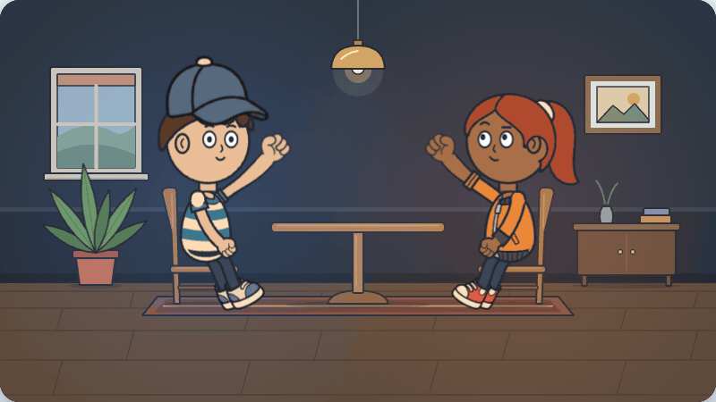
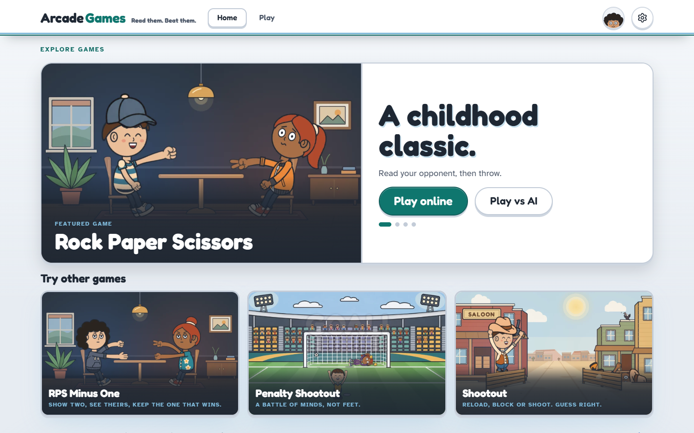
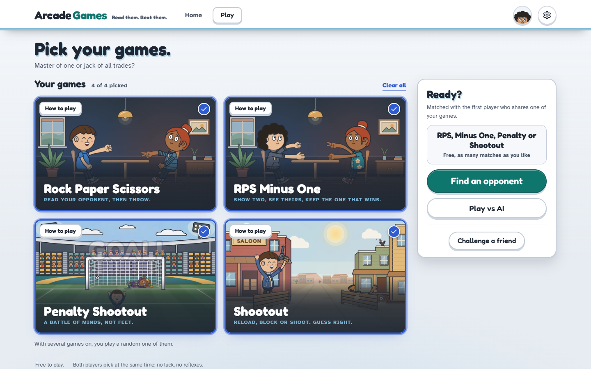
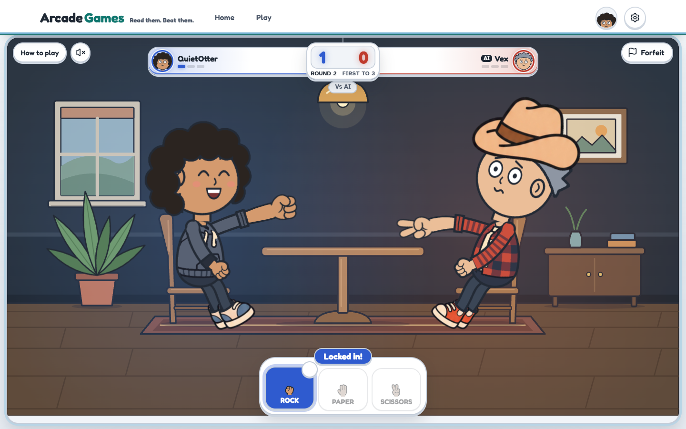
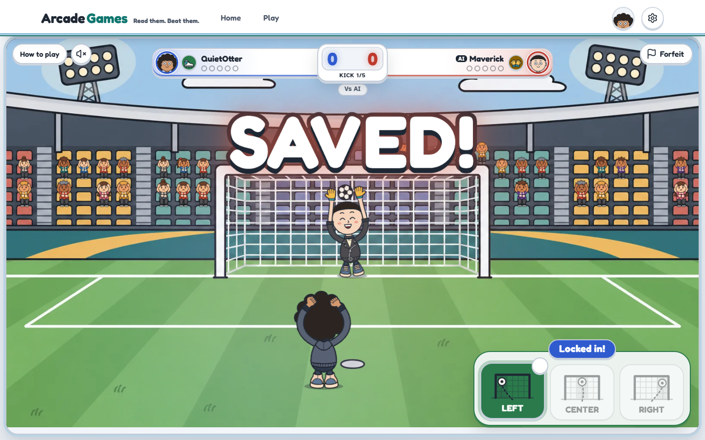
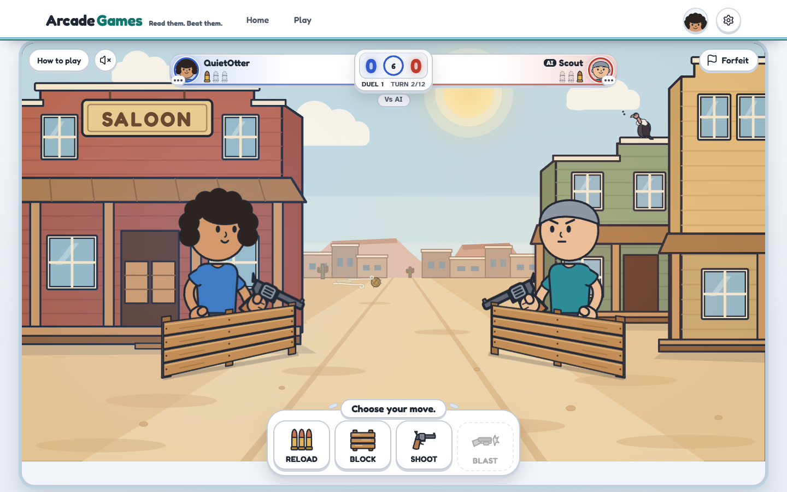
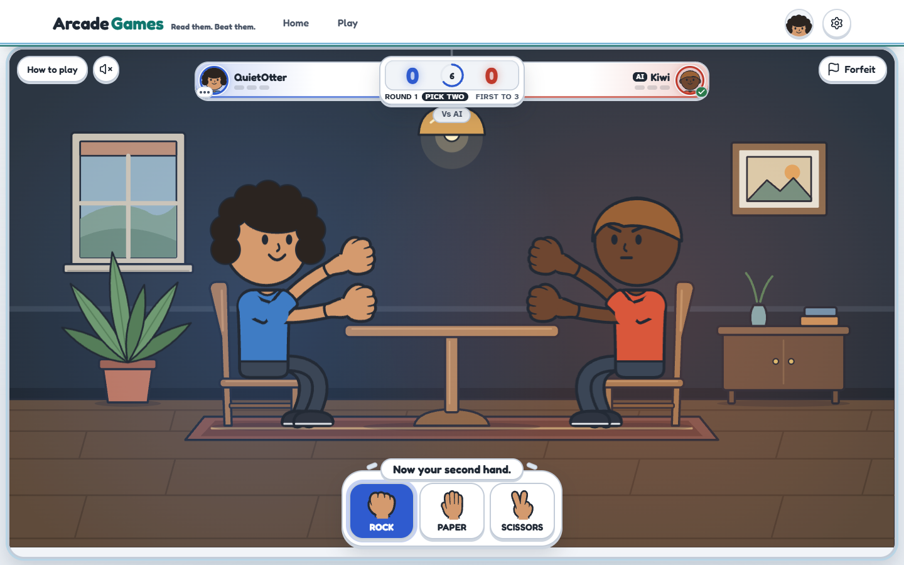
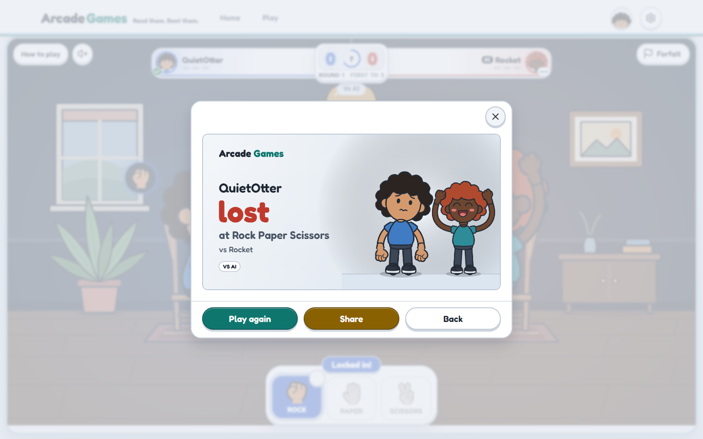
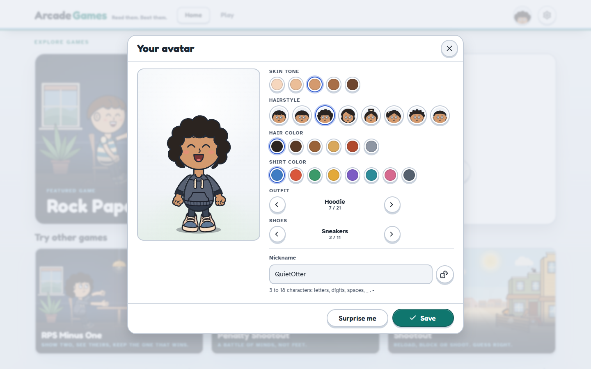

# Arcade Games

Realtime 1v1 **simultaneous mind games** in the browser. Both players pick their move at the same time, the server
locks both in, then the reveal plays out as a small animated scene. No luck, no reflexes: you win by reading your
opponent. Free to play against a computer opponent, against a random player from the queue, or against a friend
through a challenge link. Works on desktop and on phones held sideways.



| | |
|---|---|
|  |  |
|  |  |
|  |  |
|  |  |

## The games

| Game | In short |
|---|---|
| **Rock Paper Scissors** | First to 3. The classic, with a reveal at a table. |
| **RPS Minus One** | Show two hands, see theirs, then keep one of yours. |
| **Penalty Shootout** | Five kicks each, roles alternate: pick a corner as the kicker, a dive as the keeper. Sudden death after a tie. |
| **Shootout** | Reload, block or fire at high noon. Shooting someone who reloads wins the duel; a shotgun blast breaks the fence. |

Every game has an interactive tutorial that runs the real scene and the real rules in a sandbox.

## Features

- **Realtime 1v1 over socket.io**: a matchmaking queue over the games you pick (the first player who shares one of
  them; the game is picked at random among the shared ones), live lock-in status, a server timer per turn with a
  "hurry" tick in the last two seconds.
- **Server-authoritative simultaneous moves**: the client only sends its move; the server validates it against the
  game's rules, never sends the opponent's move before both are locked (or the timer ran out), resolves the round and
  broadcasts the result. Game engines are pure modules (`server/games/*.js`) shared with the browser for tutorials
  and previews.
- **AI opponent**: seven hidden personalities (random, repeat the winner, switch after a loss, a favorite move,
  mirror, cautious, aggressive) with noise and a human-like think delay. It only ever sees the public state.
- **Challenge a friend**: a one-time link (`/c/<code>`, 24 h); both players play as soon as both are online.
- **Rejoin after a reload**: a reload, a closed tab or a lost connection brings the player back into the same
  match, the same round, score and deadline (a stable random id in the browser; 30 s of grace).
- **Light anti-bot**: scripted-looking move timing (very fast with almost no variance) over several matches moves a
  player into a separate matchmaking pool for a while. It never blocks anyone or tells them anything.
- **Mobile landscape**: one layout for every screen, scaled to fit; phones get fullscreen + an orientation lock where
  the browser allows it and a "turn your phone" overlay when held upright.
- **Everything drawn in code**: the characters are a small rubber-hose rig (noodle limbs as cubic Béziers, poses
  as data, tweened with easing, idle breathing and blinking, faces per moment), the scenes, props, effects, covers
  and the result card are SVG / canvas built in JavaScript. The repository contains no raster art.
- **Avatar picker**: skin tone, hairstyle, hair color and shirt color, plus a nickname (the two players never wear
  the same shirt in a match).
- **Accessible and calm**: keyboard shortcuts in every game, focus handling in dialogs, AA contrast for text,
  `prefers-reduced-motion` respected, sound effects and music with their own switches and volumes.
- **Hardened server**: a strict Content Security Policy (no inline scripts), rate limits on every socket event,
  validated input everywhere, generic error messages (no stack traces or paths), nothing persisted.

## Tech stack

- **Server**: Node.js (20+), Express, socket.io, compression. No database: matches, the queue and challenges live in
  memory.
- **Client**: plain JavaScript, HTML and CSS (no framework, no build step), SVG scenes animated with the Web
  Animations API and a requestAnimationFrame rig, Web Audio for sound, canvas for the result card.
- **Tests**: plain Node.js scripts with `assert` (engine fuzzing, AI, units, the character rig in a tiny DOM, static
  client checks, socket-level integration, HTTP hardening), run in GitHub Actions on every push.
- **Tools**: headless Chrome over the DevTools protocol (Node's built-in WebSocket) for covers, screenshots, the
  GIF and the reveal-timing check.

## Architecture

```
 Browser (public/)                                   Server (server/)
 ┌──────────────────────────────┐   socket.io   ┌────────────────────────────────────┐
 │ app.js      pages, dialogs   │ ◄───────────► │ arena.js     queue, matches, timers │
 │ scenes/*    SVG game scenes  │  queue:join   │   ├─ matchmaking.js  (pure rules)   │
 │ characters/*   the character rig│  demo:start   │   ├─ games/*.js      (pure engines) │
 │ hud.js      scoreboard       │  match:move   │   ├─ ai/index.js     (demo opponent)│
 │ tutorial.js sandbox tutorials│  challenge:*  │   ├─ challenges.js   (links)        │
 │ engines.js  same game rules ◄┼── /js/engines │   └─ anticheat.js    (shadow pool)  │
 └──────────────────────────────┘   (bundled)   │ index.js    HTTP, CSP, static files │
                                                 │ themes.js   color tokens -> CSS     │
                                                 └────────────────────────────────────┘
```

One turn: the server sends `match:round` (the public state and the deadline) → each client sends `match:move` →
the server answers `match:locked` to the mover and `match:opponentLocked` to the other (never the move itself) →
when both are in (or the timer runs out and the default move is recorded) it resolves the round and sends
`match:roundResult` with both moves → the scenes play the reveal within the engine's animation budget → the next
`match:round`, or `match:end`.

A game engine implements `init`, `publicState`, `legalMoves`, `validateMove`, `defaultMove`, `resolveRound` and its
timing (`server/games/index.js` documents the interface); a new game is an engine, a scene module
(`public/js/scenes/`), its art (`public/js/scenes/art-<game>.js` + colors in `server/theme-scenes/`) and a
tutorial script.

## Run it

Requires Node.js 20 or newer.

```bash
npm install
npm start            # http://localhost:3000
```

Optional settings are in `.env.example` (copy it to `.env`). With `DEV_MODE=true` the scene lab at
`http://localhost:3000/dev/lab` (from this machine only) plays any reveal, pose and tutorial without a match.

To try PvP locally, open two browser windows (one of them private), pick the same game and press **Find an
opponent** in both.

## Tests

```bash
npm test
```

runs every suite: `test/games.js` (rules + 3000 fuzzed matches per game), `test/ai.js`, `test/units.js`,
`test/figures.js` (the character rig), `test/client.js` (static checks of the site files), `test/sim.js` (real
sockets: every game PvP and vs the AI, challenges, rejoin, guards) and `test/security.js`.

With the server running in dev mode (`DEV_MODE=true npm start`), `npm run timing` checks every reveal against its
animation budget in headless Chrome, `npm run covers` renders the game covers from the scenes and `npm run screens`
takes the screenshots above (`node tools/gif.js` records the GIF; it needs ffmpeg). Set `BASE_URL` when the server
is not on port 3000.

## Credits and license

Code: [MIT](LICENSE). Fonts (OFL), icons (Lucide, ISC) and sounds (all CC0) are listed in [CREDITS.md](CREDITS.md).
